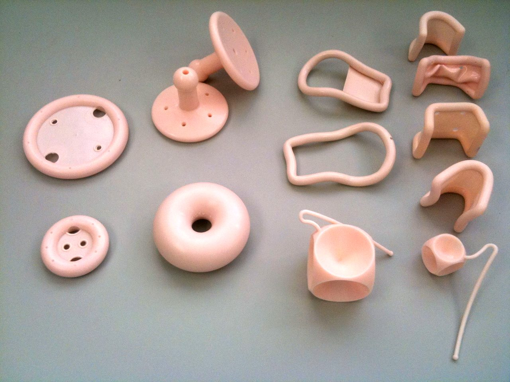

# Is a pessary right for me?

A pessary is a removable silicone device placed in the vagina to support prolapsed organs. For many women, it's all the treatment they need. Up to 92% of women can be fitted with one, and it works the same day it's placed.

## Who benefits most from a pessary?

Pessaries are a good option for women who:

- Want to avoid surgery, either for now or for good
- Have health problems that make surgery riskier
- Still plan to have children, since pregnancy after prolapse surgery can weaken the repair
- Want relief right away
- Have prolapse of any stage, including advanced prolapse

I offer a pessary to almost every prolapse patient. The risks are low. If it works, you may avoid surgery or put it off for years. If it doesn't, surgery is still available.

## What to expect at a fitting

Here's what happens:

1. I choose a pessary type and size based on your anatomy.
2. I place the pessary, and you walk around, sit, and bear down to test it.
3. If it's comfortable and stays in place, you go home with it.
4. You come back within 4 weeks so I can check the fit and teach you how to manage it yourself if that's your plan.

Finding the right fit sometimes takes 2 or 3 tries with different sizes or types. That's normal. About 15% of women switch to a different pessary type in the first year.

## Types of pessaries

Photo: Huckfinne / <a href="https://commons.wikimedia.org/wiki/File:Pessaries.JPG">Wikimedia Commons</a>, public domain

The most common types are:

- Ring pessary: the most popular choice. It can usually stay in during sex, and it's easy to take out and clean on your own.
- Ring with support: adds a membrane across the center for more support.
- Gellhorn: fills more space and gives stronger support. It's hard to take out on your own, so it usually isn't a good fit if you're sexually active.
- Cube: holds on with gentle suction. It has to come out often, so it can require frequent visits to the office or self management.

Ring and Gellhorn pessaries relieve symptoms equally well in research studies. I usually start with a ring because most women find it the easiest to live with.

## What the research shows

In a large multicenter registry, about two-thirds of women were still using their pessary at one year. Among women who kept using it, 93 to 94% said their symptoms were much better at 2 and 3 years.

Women who decide the pessary isn't for them usually figure that out within the first few months. About 1 in 4 women who stop do so because they've chosen surgery instead.

About 1 in 5 women notice new bladder leaking after a pessary is placed. The prolapse can hide stress incontinence by kinking the urethra, and the pessary undoes that kink. If this happens, we can switch to a pessary designed to help with leaking or talk about other treatments.

## Living with a pessary

Most women adjust quickly:

- You should not be able to feel the pessary once it's in place.
- You can clean it at home or have it cleaned at office visits every 3 to 6 months. Both approaches work.
- I often prescribe vaginal estrogen cream to keep the vaginal tissue healthy. Studies haven't shown that it prevents sores, but some women stay with their pessary longer when they use it.
- You can exercise, travel, and go about your normal life with a pessary in.
- [Pelvic floor physical therapy](/conditions/prolapse/what-is-pelvic-floor-physical-therapy) can go along with a pessary. In one study, women who used both had better prolapse symptoms than women who did exercises alone. We have in-office pelvic floor PTs who can work with you.

Some women notice more vaginal discharge. It's usually the body reacting to the device, not an infection. Taking the pessary out and cleaning it more often can help.

About 30% of women who use a pessary for 3 years have at least one small sore in the vagina. Most heal once the pessary comes out for a few weeks, often with vaginal estrogen. Then you can usually go back to a pessary, sometimes a different size or type.

## When a pessary may not be the best fit

A pessary may be harder to use if you:

- Can't come back for regular visits or take it out yourself, since a pessary left in too long can cause serious sores
- Have a short vagina, a wide vaginal opening, or a lot of vaginal narrowing
- Have vaginal mesh erosion, a sore that won't heal, scarring from radiation, or vaginal bleeding nobody has checked yet
- Would rather not manage a device long term

We'll check any bleeding or infection before a fitting. If you still want to try a pessary, I'll fit you. The decision is yours.

## References

- Hooper GL, Moynihan L, Leegant A, et al. Vaginal Pessary Use and Management for Pelvic Organ Prolapse. Urogynecology. 2023. [doi:10.1097/SPV.0000000000001293](https://doi.org/10.1097/SPV.0000000000001293)
- Andy UU, Meyn L, Brown HW, et al. Outcomes at 12, 24, and 36 Months in Women Treated for Pelvic Organ Prolapse With Pessary or Surgery: Results From the Multicenter Pelvic Floor Disorders Registry. Urogynecology. 2025. [doi:10.1097/SPV.0000000000001669](https://doi.org/10.1097/SPV.0000000000001669)
- Yurteri-Kaplan LA, Meyn L, Moalli PA, et al. Outcomes of Pessary Use at 1 Year in Women Treated for Pelvic Organ Prolapse in a Large Multicenter Registry. Urogynecology. 2022. [doi:10.1097/SPV.0000000000001279](https://doi.org/10.1097/SPV.0000000000001279)
- Cundiff GW, Amundsen CL, Bent AE, et al. The PESSRI study: symptom relief outcomes of a randomized crossover trial of the ring and Gellhorn pessaries. American Journal of Obstetrics and Gynecology. 2007. [doi:10.1016/j.ajog.2007.02.018](https://doi.org/10.1016/j.ajog.2007.02.018)
- Carberry CL, Tulikangas PK, Ridgeway BM, et al. American Urogynecologic Society Best Practice Statement: Evaluation and Counseling of Patients With Pelvic Organ Prolapse. Urogynecology. 2025. [doi:10.1097/SPV.0000000000001641](https://doi.org/10.1097/SPV.0000000000001641)
- Barber MD. Pelvic organ prolapse. BMJ. 2016. [doi:10.1136/bmj.i3853](https://doi.org/10.1136/bmj.i3853)
- Committee on Practice Bulletins—Gynecology, American Urogynecologic Society. Pelvic Organ Prolapse (ACOG Practice Bulletin No. 214). Obstetrics & Gynecology. 2019.
