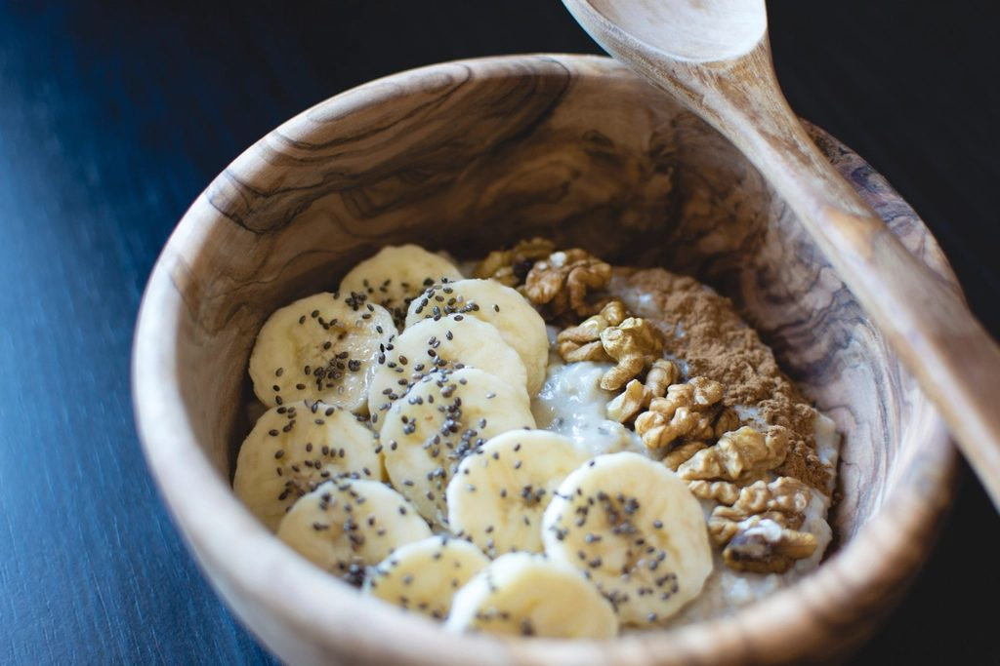
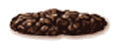
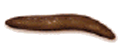

# Dietary adjustments for fecal incontinence

Stool that is soft but formed is the easiest kind to hold. Loose or watery stool is hard to keep in, and very hard stool can back up and leak around the edges. Most of what diet does for bowel leakage comes down to getting your stool into that middle range. For women with mild symptoms, diet, fiber, and stool-firming changes are often enough on their own.

## Start with your stool

The Bristol stool scale sorts stool into seven types, from hard lumps (type 1) to watery liquid (type 7). Types 3 and 4, a sausage shape that is smooth or slightly cracked, are the easiest to control.

| Stool | Type | What it looks like | What it means for you |
|:---:|:---:|---|---|
|  | 1 | Separate hard lumps, like nuts | Hard: soften it |
|  | 2 | Sausage-shaped but lumpy | Hard: soften it |
|  | 3 | Sausage-shaped with cracks on the surface | The goal |
|  | 4 | Smooth, soft sausage or snake | The goal |
|  | 5 | Soft blobs with clear-cut edges | Loose: firm it up |
|  | 6 | Fluffy, mushy pieces with ragged edges | Loose: firm it up |
|  | 7 | Watery, no solid pieces | Loose: firm it up |

<small>Drawings from the Bristol stool scale by <a href="https://commons.wikimedia.org/wiki/File:BristoStool_1.png">Jmarchn</a>, based on a chart by Cabot Health, <a href="https://creativecommons.org/licenses/by-sa/3.0/">CC BY-SA 3.0</a>.</small>

Which way you need to move decides what you change:

- Loose stool (types 5 to 7): the goal is to firm it up. Soluble fiber, especially psyllium, is the main tool, and loperamide (Imodium) can help if fiber isn't enough.
- Hard stool (types 1 and 2): the goal is to soften it. More fiber, more fluid, and sometimes a gentle laxative keep stool moving so it doesn't build up and seep out.

{: .important-title }
> Key point
>
> Foods affect people differently. A food and bowel diary is the most reliable way to find your own triggers, and it tells us more than memory does.

## Fiber

Add fiber slowly, over a few weeks. Going from little fiber to a lot at once tends to cause gas and bloating.

Soluble fiber absorbs water and forms a gel, which gives loose stool more body. In a randomized trial, a psyllium supplement reduced leakage episodes compared with placebo. Good sources include:

- Psyllium (Metamucil and store brands)
- Oats and oat bran
- Bananas
- Applesauce and peeled apples, which are rich in pectin

Insoluble fiber, the roughage in bran, fruit skins, raw vegetables, and whole grains, adds bulk and speeds stool along. That helps with hard stool. If your stool is already loose, large amounts of roughage can make it looser or bring on gas, so you may do better keeping these smaller and leaning on soluble fiber instead.

## Foods and drinks that can make leakage worse

None of these is a problem for everyone. Use your diary to see which ones matter for you.

- Caffeine (coffee, tea, energy drinks, chocolate) speeds up the bowel
- Alcohol can loosen stool
- Dairy causes diarrhea if you are lactose intolerant
- Spicy foods
- Fatty, greasy, or fried foods
- Artificial sweeteners, especially sugar alcohols like sorbitol, have a laxative effect
- Carbonated drinks add gas, and gas leakage is part of the problem for many women

{: .important-title }
> Tip
>
> Don't cut all of these at once. Remove one at a time for a week or two so you can tell which ones make a difference.

## Fluids

Drink fluids steadily through the day, and drink more as you add fiber. Fiber without enough fluid can leave stool hard. If constipation is your problem, more fluid matters even more. If caffeine or alcohol is one of your triggers, swap in water or decaf rather than cutting back on fluid overall.

## Making the changes stick

1. Keep a food and bowel diary for two to three weeks. Write down what you eat and drink, when you have a bowel movement, what the stool looks like, and any leaks.
2. Change one thing at a time so you can tell what helped.
3. Increase fiber gradually.
4. Eat at regular times. If leaks tend to come after meals, smaller and more frequent meals may help.
5. Bring the diary to your appointment.

## Supplements and medicine

- Psyllium is the fiber supplement with the best evidence for bowel leakage. Start low and build up.
- Loperamide (Imodium) firms stool and reduces urgency. In a trial comparing the two, both psyllium and loperamide reduced leakage episodes, and constipation was more common with loperamide. It is sold over the counter, but ask before taking it every day so we can set the dose.
- Probiotics are popular, but there isn't good evidence that they help bowel leakage.

## When to get checked

See a doctor before relying on diet changes if you have:

- Bright red blood in your stool or black, tarry stools
- Watery diarrhea that won't go away
- No colon cancer screening and you are 45 or older

You also don't have to finish a long trial of diet changes before looking at other treatments. Diet works well alongside [pelvic floor physical therapy](/treatments/fecal-incontinence/physical-therapy), [bowel retraining](/treatments/fecal-incontinence/bowel-retraining), and the other options on the [fecal incontinence treatments](/treatments/fecal-incontinence) page. If leakage is affecting your life, we can talk through those at the same visit.

## References

- Brown HW, Dyer KY, Rogers RG. Management of Fecal Incontinence. Obstetrics & Gynecology. 2020. [doi:10.1097/AOG.0000000000004054](https://doi.org/10.1097/AOG.0000000000004054)
- Meyer I, Richter HE. Accidental Bowel Leakage/Fecal Incontinence: Evidence-Based Management. Obstetrics and Gynecology Clinics of North America. 2021. [doi:10.1016/j.ogc.2021.05.003](https://doi.org/10.1016/j.ogc.2021.05.003)
- Sultan AH, Monga A, Lee J, et al. An International Urogynecological Association (IUGA)/International Continence Society (ICS) joint report on the terminology for female anorectal dysfunction. International Urogynecology Journal. 2017. [doi:10.1007/s00192-016-3140-3](https://doi.org/10.1007/s00192-016-3140-3)
